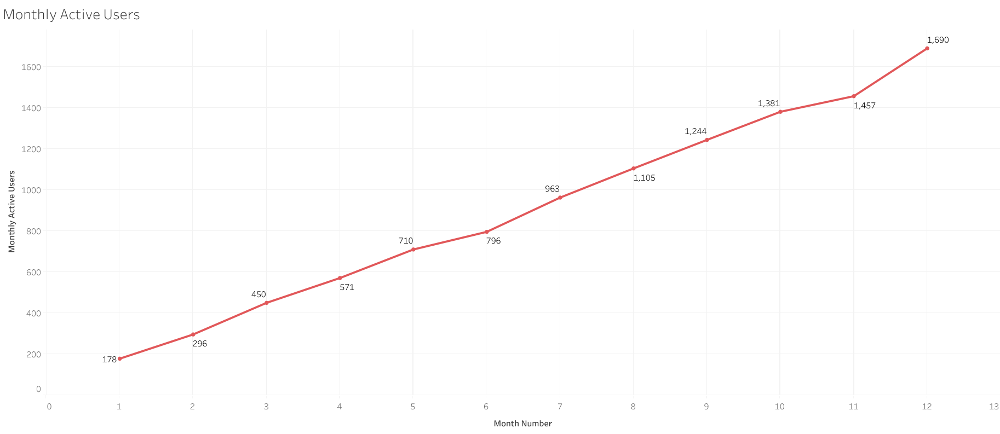

# Streaming User Retention Analysis

## Project Overview

This project analyzes user activity and subscription data for a simulated music streaming service. The goal of the project is to understand user growth, engagement, retention, churn, reactivation, and Premium subscription performance.

The dataset contains 3,000 users and 30,000 login records from 2025. Using SQLite, I analyzed user behavior across multiple dimensions including time, location, device type, marketing channel, and subscription status.

This project was created to strengthen my SQL and data analysis skills by working through business questions that become progressively more complex.

## Project Goals

The analysis focuses on answering questions such as:

* How is the platform's user base growing?
* How many users are active each month?
* How many users return from the previous month?
* How many inactive users reactivate?
* How many users churn?
* What is the monthly retention rate?
* Which locations and devices have the highest activity?
* Which marketing channels bring in the most Premium subscribers?
* Which countries generate the most subscription revenue?
* Which cities and devices have the highest Premium conversion rates?

## Dataset

The project uses three simulated datasets:

### `users`

Contains information about each registered user.

* `user_id` — Unique user identifier
* `signup_date` — Date the user joined
* `country` — User's country
* `city` — User's city
* `device_type` — iPhone, Android, or Web
* `marketing_channel` — Channel through which the user was acquired

### `user_logins`

Contains user login activity throughout 2025.

* `login_id` — Login record identifier
* `user_id` — User associated with the login
* `login_date` — Date of the login

### `subscriptions`

Contains subscription information for each user.

* `user_id` — User identifier
* `subscription_type` — Free or Premium
* `monthly_revenue` — Monthly subscription revenue generated by the user

## Business Questions

The SQL analysis consists of 15 questions:

1. Are there duplicate login events?
2. Are there any missing or invalid values?
3. How many new users signed up each month?
4. How many Monthly Active Users (MAU) are there?
5. Which cities have the most active users?
6. Which device type has the highest activity?
7. How many retained users returned from the previous month?
8. How many reactivated users came back?
9. How many users churned each month?
10. What is the monthly retention rate?
11. Which marketing channel brings the most Premium subscribers?
12. Which countries generate the most subscription revenue?
13. Which cities have the highest Premium conversion rate?
14. Which device type has the highest Premium conversion?
15. Create an executive monthly dashboard combining the major user metrics.

Each question has its own SQL file so the progression of the analysis can be followed individually.

## Key Findings

* Monthly Active Users increased throughout 2025, with no month experiencing a decline. 
  The largest month-over-month increase in MAU occurred between June and July.
  
* Monthly retention remained relatively stable at around 60%.
* October had the highest retention rate at 67%, while February had the lowest at 52%.
* The number of retained users generally increased throughout the year.
* Reactivated users were present across multiple months, with a particularly large increase between November and December.
* Android had the highest number of active users, although iPhone followed closely.
* Organic generated the largest number of Premium subscribers.
* The United States generated the most subscription revenue by a noticeable margin, followed by Brazil and Mexico.
* Brasília had the highest Premium conversion rate among the cities analyzed.
* Premium conversion rates were relatively similar across Web, Android, and iPhone users.

## Tools & SQL Skills

**Tools**

* SQLite
* GitHub
* CSV

**SQL concepts used**

* `SELECT`, `WHERE`, `GROUP BY`, and `ORDER BY`
* Aggregate functions including `COUNT()` and `SUM()`
* `COUNT(DISTINCT)`
* `INNER JOIN` and `LEFT JOIN`
* Common Table Expressions (CTEs)
* Self joins
* `CASE` statements
* Conditional aggregation
* Date manipulation with SQLite
* Monthly cohort comparisons
* Retention, churn, and reactivation calculations
* Conversion-rate calculations

## Repository Structure

```text
├── data/
│   ├── users.csv
│   ├── user_logins.csv
│   └── subscriptions.csv
│
├── database/
│   └── streaming_retention.db
│
├── sql/
│   ├── 01_duplicate_login_events.sql
│   ├── 02_missing_invalid_values.sql
│   ├── ...
│   ├── 14_device_premium_conversion.sql
│   └── 15_executive_dashboard.sql
│
└── README.md
```

## What I Learned

This project gave me more practice using SQL to work through business questions rather than only focusing on individual SQL concepts.

One of my biggest takeaways was gaining a better understanding of INNER JOIN and LEFT JOIN, especially when analyzing retention and churn. I became more comfortable deciding which join to use based on the question I was trying to answer, such as finding users who returned compared with users who did not return.

I also gained more experience working with dates. Date functions were not something I had encountered as often in previous SQL practice problems, so this project gave me an opportunity to use them extensively when comparing user activity across months. I also learned how to use SQLite's STRFTIME() function to extract and work with parts of a date.

Questions 7 through 10 provided additional practice with CTEs. I was already comfortable with the basic concept of CTEs, but these questions helped me use them in more complex analyses involving retained, reactivated, and churned users.

Questions 8 and 9 were the most challenging parts of the project. Determining the logic for reactivated and churned users required me to think carefully about what each business question was actually asking before writing the SQL. Working through those problems helped me improve how I break down a more complicated SQL question into smaller logical steps.

The remaining questions reinforced concepts I had previously practiced, including aggregation, grouping, filtering, joins, and CASE statements. Overall, the project helped me become more comfortable translating business questions into SQL rather than simply practicing SQL syntax in isolation.
